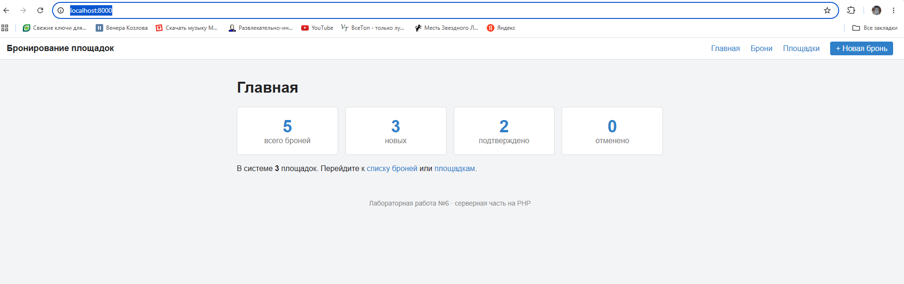
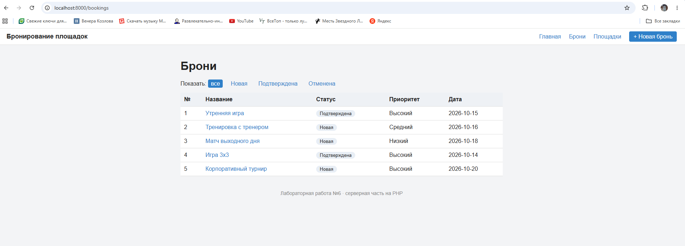
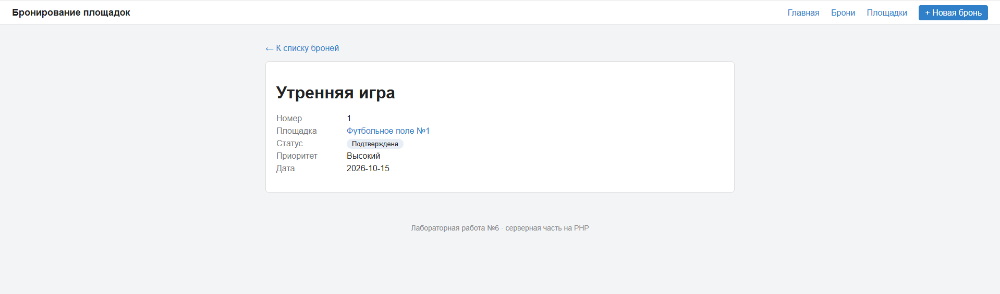
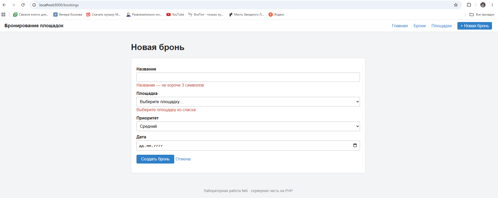
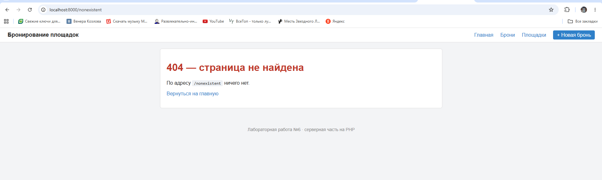
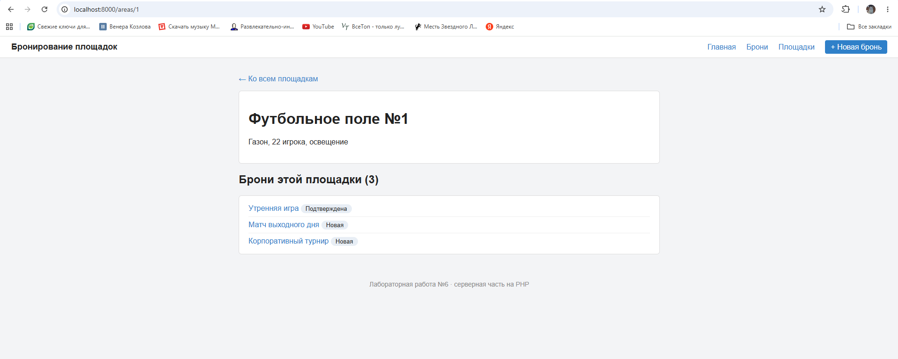

# Лабораторная работа №6

## Разработка серверной части приложения

## Цель работы

Изучить основы разработки серверной части веб-приложений на PHP, создать структуру проекта, реализовать маршрутизацию HTTP-запросов и разработать контроллеры для обработки запросов пользователей.

## Краткое описание выполненного задания

На основе архитектуры системы «Бронирование спортивных площадок» (лабораторные работы №3–5) создана основа серверной части приложения на PHP 8.2+ по паттерну MVC: единая точка входа, собственный маршрутизатор, три контроллера, модели и HTML-шаблоны. Сервер отвечает страницами: главная со сводкой, список броней с фильтром, просмотр брони, форма создания, список площадок и просмотр площадки.

Данные хранятся в JSON-файлах (`src/storage/`), работа с ними вынесена в модели. База данных будет подключена в следующих работах: контроллеры и шаблоны при этом менять не потребуется.

## Предметная область

| Что определить | Значение |
|----------------|----------|
| Основная сущность | бронь (booking, bookings) |
| Связанная сущность | площадка (area, areas) |
| Поля основной сущности | id, area_id, title, status, priority, due_date |
| Поле для фильтра | status: new, confirmed, cancelled |
| Поля связанной сущности | id, name, description |
| Данные | 5 броней, 3 площадки (storage/bookings.json, storage/areas.json) |

Перенос выполнен с демонстрационного примера «Система управления задачами»: переименованы сущности (task → booking, project → area), заменены поля, обновлены маршруты, контроллеры, модели, шаблоны и файлы данных. Работа проверена на всех страницах: главная, списки, просмотр, форма с ошибками, страница 404.

**Запуск:**
```bash
cd lab6/src
php -S localhost:8000 -t public
```
Открыть http://localhost:8000.

## Описание структуры проекта

```
src/
├── public/                       # единственная папка, доступная из интернета
│   ├── index.php                 # единая точка входа (front controller)
│   └── css/style.css
├── app/
│   ├── autoload.php              # автозагрузка классов по пространству имён
│   ├── helpers.php               # функции e(), view(), redirect(), notFound(), config()
│   ├── Core/Router.php           # маршрутизатор
│   ├── Controllers/              # HomeController, BookingController, AreaController
│   ├── Models/                   # BookingRepository, AreaRepository
│   └── Views/                    # шаблоны: layout/, errors/, bookings/, areas/, home.php
├── routes/web.php                # таблица маршрутов
├── config/app.php                # настройки
└── storage/                      # данные: bookings.json, areas.json
```

| Каталог | Назначение |
|---------|------------|
| `public/` | точка входа и статические файлы. Только эта папка открыта серверу (`-t public`), поэтому код и данные недоступны по прямому адресу |
| `app/Controllers/` | контроллеры: принимают запрос, обращаются к моделям, выбирают шаблон |
| `app/Models/` | модели: единственное место, которое знает, где и как хранятся данные |
| `app/Views/` | шаблоны страниц (PHP внутри HTML), общая шапка и подвал вынесены в `layout/` |
| `app/Core/` | ядро приложения: маршрутизатор |
| `routes/` | таблица соответствия «адрес — контроллер и метод» |
| `config/` | настройки приложения |
| `storage/` | файлы с данными |

Классы подключаются автоматически: функция `spl_autoload_register` по имени класса `App\Controllers\BookingController` находит файл `app/Controllers/BookingController.php`, поэтому в коде нет ни одного `require` для классов.

## Описание механизма маршрутизации

Все запросы направляются в `public/index.php` (front controller). Он подключает автозагрузку и вспомогательные функции, создаёт `Router`, загружает таблицу маршрутов `routes/web.php` и передаёт маршрутизатору метод и адрес запроса.

Таблица маршрутов:

| Метод | Адрес | Контроллер и метод | Назначение |
|-------|-------|-------------------|------------|
| GET | `/` | `HomeController::index` | главная страница |
| GET | `/bookings` | `BookingController::index` | список броней (фильтр `?status=`) |
| GET | `/bookings/create` | `BookingController::create` | форма создания |
| POST | `/bookings` | `BookingController::store` | приём формы |
| GET | `/bookings/{id}` | `BookingController::show` | просмотр брони |
| GET | `/areas` | `AreaController::index` | список площадок |
| GET | `/areas/{id}` | `AreaController::show` | площадка и её брони |

Алгоритм `Router::dispatch()`:

1. Из адреса `/bookings/5?status=confirmed` выделяется путь `/bookings/5`.
2. Маршруты просматриваются по порядку. Пропускаются маршруты с другим методом.
3. Для маршрута с подходящим методом метод `match()` превращает шаблон `/bookings/{id}` в регулярное выражение и возвращает параметры (`['id' => '5']`) или `null`, если адрес не подошёл.
4. Для подошедшего маршрута создаётся объект контроллера, и вызывается его метод, а параметры из адреса передаются как именованные аргументы (`show(string $id)`).
5. Если подходящего маршрута нет, возвращается страница 404 с кодом ответа 404.

Порядок регистрации важен: маршрут `/bookings/create` зарегистрирован выше `/bookings/{id}`. Иначе слово `create` было бы принято за номер брони.

Ошибки выполнения (исключения) перехватываются в `public/index.php`: приложение возвращает код 500 и страницу ошибки. Подробный текст ошибки показывается только при `debug = true` в `config/app.php`.

## Описание реализованных контроллеров

| Контроллер | Метод | Что делает |
|------------|-------|------------|
| `HomeController` | `index` | считает брони по статусам и площадки, показывает главную |
| `BookingController` | `index` | список броней; при `?status=confirmed` оставляет только выбранный статус |
| | `show($id)` | одна бронь и её площадка; если брони нет, страница 404 |
| | `create` | форма создания с выпадающим списком площадок |
| | `store` | читает `$_POST`, проверяет данные на сервере; при ошибках показывает форму с подсказками и кодом 422, иначе сохраняет бронь и перенаправляет на `/bookings` (код 302) |
| `AreaController` | `index` | список площадок |
| | `show($id)` | площадка и список её броней; если площадки нет, страница 404 |

Передача данных между слоями:

- **маршрутизатор → контроллер**: параметры адреса (`{id}`) как аргументы метода;
- **запрос → контроллер**: `$_GET` (фильтр) и `$_POST` (форма);
- **контроллер → шаблон**: функция `view('bookings/show', ['booking' => $booking, ...])`, ключи массива становятся переменными в шаблоне;
- **модель → контроллер**: массивы данных (`all()`, `find()`, `byArea()`, `add()`).

Все значения в шаблонах выводятся через функцию `e()` (`htmlspecialchars`), поэтому внедрить HTML-код через название брони невозможно.

## Проверка работы приложения

| Запрос | Результат |
|--------|-----------|
| `GET /` | 200, карточки: 5 броней, 2 новых, 2 подтверждено, 0 отменено |
| `GET /bookings` | 200, 5 строк |
| `GET /bookings?status=confirmed` | 200, 2 строки |
| `GET /bookings?status=zzz` | 200, сообщение «Брони не найдены» |
| `GET /bookings/1` | 200, бронь №1 и название площадки |
| `GET /bookings/999`, `GET /bookings/abc` | 404 |
| `GET /bookings/create` | 200, форма (маршрут не перехвачен шаблоном `{id}`) |
| `POST /bookings` с названием «Да» без площадки | 422, подсказки у полей, введённое значение сохранено |
| `POST /bookings` с некорректным приоритетом | 422 |
| `POST /bookings` с корректными данными | 302 → 200 на `/bookings`, новая бронь в списке и в `storage/bookings.json` |
| `GET /areas/2` | 200, площадка и её брони |
| `GET /areas/99`, `GET /nonexistent` | 404 |
| `POST /areas` | 404 (для адреса есть только маршрут GET) |

### Главная страница


### Список броней


### Просмотр брони


### Форма создания с ошибками проверки (код 422)


### Несуществующий адрес (код 404)


### Просмотр площадки


## Вывод

В результате работы создана основа серверной части приложения на PHP по паттерну MVC: определена структура проекта, реализован маршрутизатор, который регистрирует маршруты, выбирает контроллер по методу и адресу, передаёт ему параметры из адреса и возвращает страницу 404 для несуществующих маршрутов. Разработаны три контроллера, обрабатывающие основные сценарии: просмотр главной страницы, списков и отдельных объектов, создание объекта через форму с проверкой данных на сервере. Разделение на модели, представления и контроллеры позволит заменить файл базой данных и добавить REST API, не переписывая остальной код.

## Структура репозитория

```
lab6/
├── README.md
├── src/          # исходный код (см. «Описание структуры проекта»)
└── images/
    ├── 01-home.png
    ├── 02-bookings.png
    ├── 03-booking.png
    ├── 04-create-errors.png
    ├── 05-404.png
    └── 06-area.png
```