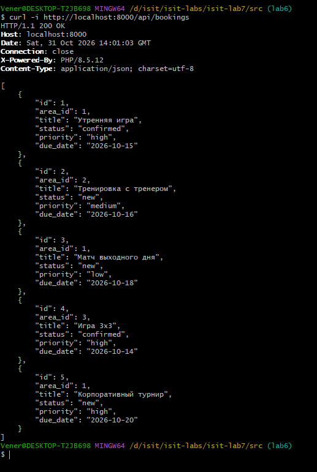
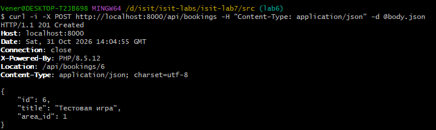
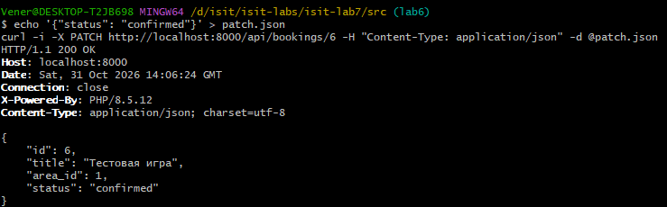
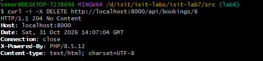

# Лабораторная работа №7

## Проектирование REST API

## Цель работы

Изучить принципы проектирования REST API, разработать набор ресурсов информационной системы, реализовать основные HTTP-методы, подготовить документацию API и выполнить тестирование запросов.

## Краткое описание выполненного задания

На основе серверной части из лабораторной работы №6 («Бронирование спортивных площадок», PHP, MVC) реализован REST API с тремя ресурсами: брони, площадки, пользователи. Для каждого ресурса поддержаны операции CRUD через методы `GET`, `POST`, `PUT/PATCH`, `DELETE`; ответы возвращаются в формате JSON с корректными кодами состояния (200, 201, 204, 400, 404, 405, 409, 422, 500). Сайт из лабораторной работы №6 продолжает работать.

## Предметная область

| Что определить | Значение |
|---|---|
| Основная сущность | бронь (booking, bookings) |
| Связанная сущность | площадка (area, areas) |
| Третья сущность | пользователь (user, users) |
| Поля основной сущности | id, area_id, title, status (new, confirmed, cancelled), priority, due_date |
| Поля третьей сущности | id, name, email, role |

Перенос выполнен с демонстрационного примера «Система управления задачами»: переименованы сущности (task → booking, project → area, user → user), изменены поля, маршруты, контроллеры, модели и данные.

**Запуск:**
```bash
cd lab7/src
php -S localhost:8000 -t public
```
Открыть http://localhost:8000.

## Описание реализованных ресурсов

| Ресурс | URL | Методы | Назначение | Формат данных |
|---|---|---|---|---|
| Брони | `/api/bookings`, `/api/bookings/{id}` | GET, POST, PUT/PATCH, DELETE | учёт броней | id, area_id, title, status, priority, due_date |
| Площадки | `/api/areas`, `/api/areas/{id}`, `/api/areas/{id}/bookings` | GET, POST, PUT/PATCH, DELETE | площадки и их брони | id, name, description |
| Пользователи | `/api/users`, `/api/users/{id}` | GET, POST, PUT/PATCH, DELETE | пользователи системы | id, name, email, role |

Адреса — существительные во множественном числе; действие определяется HTTP-методом; связь «площадка — её брони» выражена вложенным адресом; фильтры передаются строкой запроса (`?status=confirmed&area_id=1`).

## Описание REST API

Полная документация с параметрами, примерами запросов и ответов: [docs/api.md](docs/api.md). Сводная таблица:

| Метод | URL | Назначение | Успешный код |
|---|---|---|---|
| GET | `/api/bookings` | список броней (status, area_id) | 200 |
| GET | `/api/bookings/{id}` | бронь по номеру | 200 |
| POST | `/api/bookings` | создать бронь | 201 |
| PUT, PATCH | `/api/bookings/{id}` | изменить бронь | 200 |
| DELETE | `/api/bookings/{id}` | удалить бронь | 204 |
| GET, POST | `/api/areas` | список / создание площадки | 200 / 201 |
| GET, PUT, PATCH, DELETE | `/api/areas/{id}` | площадка: чтение, изменение, удаление (409, если есть брони) | 200 / 204 |
| GET | `/api/areas/{id}/bookings` | брони площадки | 200 |
| GET, POST | `/api/users` | список / создание пользователя | 200 / 201 |
| GET, PUT, PATCH, DELETE | `/api/users/{id}` | пользователь: чтение, изменение, удаление | 200 / 204 |

Устройство реализации:
- маршруты `routes/web.php`; маршрутизатор `Router` поддерживает `get`, `post`, `put`, `patch`, `delete` и сам возвращает JSON-ответы 404 и 405 (с заголовком `Allow`) для адресов `/api/...`;
- контроллеры `app/Controllers/Api/`: по пять методов `index`, `show`, `store`, `update`, `destroy`; PUT и PATCH обрабатываются одним методом `update` (присланные поля заменяют старые);
- модели наследуют от `JsonRepository` (`all`, `find`, `add`, `update`, `delete`), данные в `storage/*.json`;
- помощники `json_response()`, `json_error()`, `no_content()`, `json_input()` в `app/helpers.php`;
- данные проверяются на сервере (`validate()`), ошибки возвращаются все сразу в формате `{"error": "...", "errors": {"поле": "..."}}`.

## Примеры запросов и ответов

### Создание брони (POST /api/bookings)

```http
POST /api/bookings
Content-Type: application/json

{ "title": "Тестовая игра", "area_id": 1 }
```

```http
HTTP/1.1 201 Created
Location: /api/bookings/6

{ "id": 6, "area_id": 1, "title": "Тестовая игра", "status": "new", "priority": "medium", "due_date": null }
```

### Ошибка проверки (POST /api/bookings с телом `{"title":"Да"}`), код 422

```json
{
    "error": "Ошибка проверки данных",
    "errors": {
        "title": "Название — не короче 3 символов",
        "area_id": "Площадки с таким номером нет"
    }
}
```

### Изменение (PATCH /api/bookings/6, тело `{"status": "confirmed"}`)
Код 200, меняется только статус.

### Удаление (DELETE /api/bookings/6)
Код 204, тела нет; повторное удаление — 404.

### Метод не поддержан (DELETE /api/users)
Код 405, заголовок `Allow: GET, POST`.

### Конфликт (DELETE /api/areas/1, у площадки есть брони)
Код 409, `{"error": "Нельзя удалить площадку: у неё есть брони"}`.

## Тестирование

Выполнено 18 запросов (успешные и ошибочные, по всем трём ресурсам), результаты — в [docs/testing.md](docs/testing.md). Во всех строках получен ожидаемый код.

### GET: список с фильтром и брони площадки


### POST: создание (201, Location)


### PATCH: изменение


### DELETE: 204 и повторное удаление (404)


### Ошибки 422 и 400


### Ошибки 405, 409, 404


## Вывод

В результате работы спроектированы три ресурса информационной системы и реализован REST API на PHP: адреса строятся по правилам REST, действия задаются HTTP-методами, поддерживаются все операции CRUD, данные передаются в JSON, а результат сообщается кодами состояния 200, 201, 204, 400, 404, 405, 409 и 422. Серверная проверка входных данных и единый формат ошибок облегчают работу клиентского приложения, а документация (`docs/api.md`) и таблица тестирования (`docs/testing.md`) позволяют воспроизвести и проверить каждый запрос. Структура «маршрут — контроллер — модель» из лабораторной работы №6 позволяет заменить файловое хранилище базой данных, не меняя контроллеры.

## Структура репозитория

```
lab7/
├── README.md
├── src/          # исходный код (сайт из лабораторной работы №6 + REST API)
├── images/       # скриншоты тестирования (6 файлов)
└── docs/
    ├── api.md        # документация API
    └── testing.md    # результаты тестирования
```