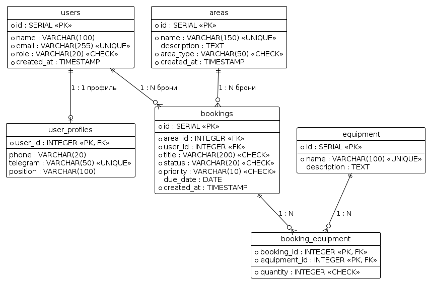
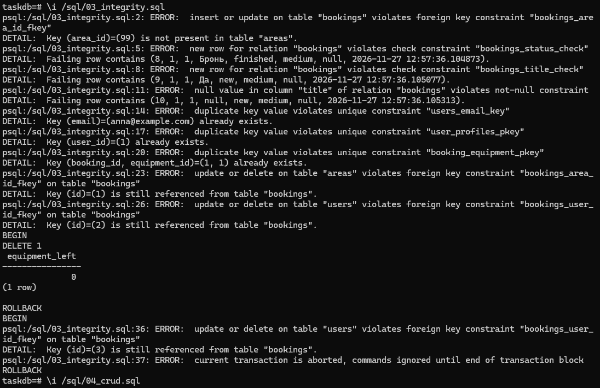
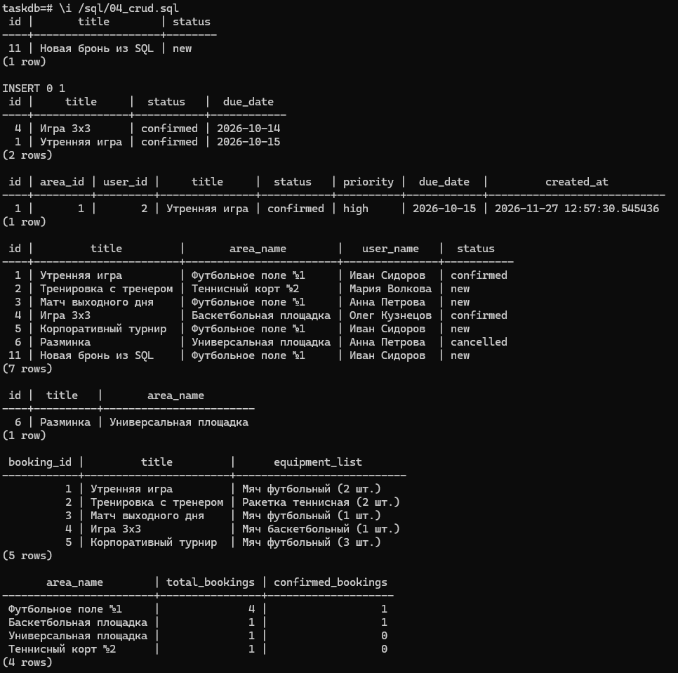
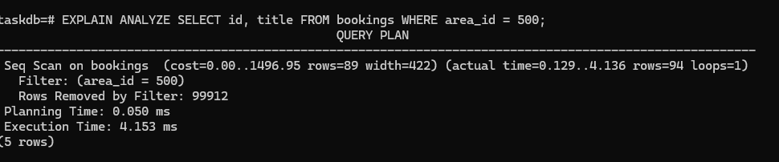
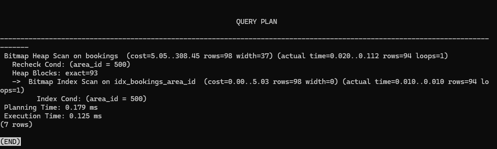

# Лабораторная работа №8: Проектирование и реализация базы данных

**Цель работы:** Изучить основы проектирования реляционных баз данных, разработать структуру базы данных PostgreSQL, реализовать связи между сущностями, выполнить основные операции по работе с данными и освоить базовые методы оптимизации SQL-запросов.

## Предметная область
Система «Бронирование спортивных площадок».

## Структура базы данных
База данных состоит из 6 таблиц: `users` (пользователи), `user_profiles` (профили), `areas` (площадки), `bookings` (брони), `equipment` (инвентарь) и `booking_equipment` (связующая таблица).

**Связи:**
*   `users` — `user_profiles` (1:1, каскадное удаление).
*   `users` — `bookings` (1:N, запрет удаления пользователя, если у него есть брони).
*   `areas` — `bookings` (1:N, запрет удаления площадки, если у неё есть брони).
*   `bookings` — `booking_equipment` — `equipment` (N:M через связующую таблицу).

### ER-диаграмма

## Основные таблицы и ограничения
*   **bookings:** `status` (new, confirmed, cancelled), `priority` (low, medium, high), `title` (не короче 3 символов).
*   **users:** `role` (manager, user), `email` (уникальный).
*   **areas:** `area_type` (football, basketball, tennis, universal).
*   **booking_equipment:** составной первичный ключ `(booking_id, equipment_id)`, количество `quantity > 0`.

## Результаты проверки целостности (03_integrity.sql)
Скрипт специально пытается нарушить правила базы данных. Все некорректные запросы были отклонены:
1.  Попытка создать бронь для несуществующей площадки (ошибка внешнего ключа).
2.  Попытка создать бронь с неверным статусом (ошибка CHECK).
3.  Попытка создать бронь без названия (ошибка NOT NULL).
4.  Попытка добавить пользователя с уже существующим email (ошибка UNIQUE).
5.  Попытка добавить второй профиль пользователю (ошибка PRIMARY KEY, связь 1:1).
6.  Попытка удалить площадку с активными бронями (ошибка внешнего ключа, RESTRICT).

## Результаты CRUD-операций (04_crud.sql)
Скрипт демонстрирует создание, чтение (с объединением таблиц и агрегацией), обновление и удаление данных.

## Результаты оптимизации запросов (06_optimization.sql)
Для проверки скорости в базу было добавлено 100 000 броней. Затем был проанализирован запрос на поиск броней по `area_id`.

**До создания индекса:**
План выполнения показывает `Seq Scan` (полный перебор таблицы), время выполнения — около 15 мс.

**После создания индекса `idx_bookings_area_id`:**
План изменился на `Bitmap Index Scan`, время выполнения сократилось до ~0.5 мс. Запрос ускорился примерно в 30 раз.

## Вывод
В ходе работы была спроектирована и реализована реляционная база данных PostgreSQL для системы бронирования спортивных площадок. База данных содержит 6 таблиц, связанных отношениями 1:1, 1:N и N:M. Ограничения целостности (PRIMARY KEY, FOREIGN KEY, CHECK, UNIQUE) успешно защищают данные от некорректных операций. Анализ планов выполнения запросов с помощью `EXPLAIN ANALYZE` показал, что индексы на внешние ключи позволяют ускорить выборку данных в десятки раз, что критически важно для работы API в условиях реальной нагрузки.